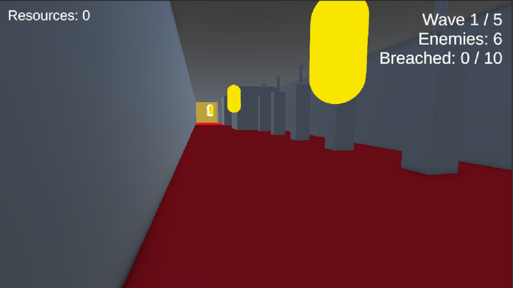

# Tower Defense

Een first-person tower defense voor pc, gemaakt in Unity. Je graaft zelf het gangenstelsel van een toren, plaatst torens en vallen in die gangen en houdt vijanden tegen die hun weg zoeken naar jouw spawnkamer.



**Genre:** tower defense, tactisch | **Platform:** pc | **Engine:** Unity 6 (6000.0.37f1) | **Taal:** C#

## Het spel

De wereld is een driedimensionaal grid van blokken. Je loopt rond in first person en graaft blokken weg om gangen te maken. Vijanden kennen de kaart niet: ze lopen door de gangen en kiezen op kruisingen zelf een richting. Met de indeling van je gangen en met lokaas (zoals de schatkist) stuur je ze, en met torens en vallen verdedig je.

**Winnen:** overleef alle 5 waves.
**Verliezen:** 10 vijanden raken de opening van de spawnkamer. Die 10 doorbraken zijn je levens.

## Besturing

| Actie | Toets |
|---|---|
| Lopen | W A S D |
| Springen | Spatie |
| Rondkijken | Muis |
| Graven, of een gekozen toren plaatsen | Linkermuisknop |
| Torenmenu openen | Rechtermuisknop |
| Gekozen toren annuleren | Escape |
| Volgende wave starten | E |

## Zo speel je

1. Graaf een gang van de ingang (het gele blok) naar de spawnkamer. Zolang er geen pad is, kan er geen wave beginnen.
2. Open het torenmenu met de rechtermuisknop en kies een toren of trap.
3. Plaats hem met de linkermuisknop. Dit kost resources, je begint met 500.
4. Druk op **E** om een wave te starten. Rechtsboven zie je de wave, het aantal vijanden en het aantal doorbraken.
5. Verdiende resources (voor dode vijanden en na elke wave) gebruik je om meer te bouwen.

## Torens en vallen

| Naam | Klasse | Wat doet het |
|---|---|---|
| Standaardtoren | `Tower` | Schiet op de dichtstbijzijnde vijand |
| Stuntoren | `TowerStun` | Bevriest of vertraagt vijanden (`StunBullet`) |
| Bomtoren | `TowerBomb` | Schade in een gebied (`BombBullet`) |
| Schatkist | `TowerChest` | Schiet niet, maar lokt vijanden naar zijn gang |
| Trap | `Trap` | Doet eenmalig schade aan vijanden in de buurt, op de vloer |

## Vijanden

| Vijand | Klasse | Levenspunten | Gedrag |
|---|---|---|---|
| Basisvijand | `Enemy` | 100 | Geen bijzonder gedrag |
| Runner | `RunnerEnemy` | 40 | 2,5 keer zo snel en klein |
| Tank | `TankEnemy` | 400 | Half zo snel, krijgt 30% minder schade |
| Healer | `HealerEnemy` | 70 | Heelt vijanden in de buurt |
| Splitter | `SplitterEnemy` | 120 | Splitst bij zijn dood in 2 vijanden |
| Shielded | `ShieldedEnemy` | 80 plus 60 schild | Schild herstelt als hij met rust gelaten wordt |
| Boss | `BossEnemy` | 1500 | Immuun voor stun, wordt sneller en roept minions op onder 50% |

## Waves

| Wave | Vijanden | Types | Boss |
|---|---|---|---|
| 1 | 6 | de eerste 2 | nee |
| 2 | 8 | de eerste 3 | nee |
| 3 | 10 | de eerste 4 | nee |
| 4 | 12 | de eerste 5 | nee |
| 5 | 12 | alle 6 | ja |

Na elke wave krijg je 100 resources. Alle waarden staan in de Inspector van de `WaveManager`.

## Starten

1. Installeer [Unity Hub](https://unity.com/download) en daarmee **Unity 6000.0.37f1**.
2. Clone deze repository of download hem als zip.
3. Klik in Unity Hub op **Add** en kies de projectmap.
4. Open het project en open de scene in `Assets/Scenes`.
5. Druk op **Play**.

## Overerving

Torens, kogels en vijanden gebruiken overerving. Een subklasse overschrijft alleen wat anders is.

```
Tower                       Bullet                      Enemy
├── TowerStun               ├── StunBullet              ├── RunnerEnemy
├── TowerBomb               └── BombBullet              ├── TankEnemy
└── TowerChest                                          │   └── BossEnemy
                                                        ├── HealerEnemy
                                                        ├── SplitterEnemy
                                                        └── ShieldedEnemy
```

## Projectstructuur

| Map | Inhoud |
|---|---|
| `Assets/Scripts/Towers` | Torens en het torenmenu |
| `Assets/Scripts/Bullets` | Kogels en effecten |
| `Assets/Scripts/Enemy` | Vijanden, beweging en navigatie |
| `Assets/Scripts/Player` | Speler, camera en bouwen |
| `Assets/Scripts/Waves` | Waves en spawnen |
| `Assets/Scripts/WorldGen` | Het grid, de ingang en de padcontrole |
| `Assets/Prefabs` | Blokken, vijanden, kogels en plaatsbare objecten |
| `Assets/Resources` | Vijandprefabs en torenicoontjes |

## Hoe het werkt

- **Wereld:** `WorldGen` bouwt een grid. Alle blokken staan in één lijst. Graven haalt een blok eruit, plaatsen voegt er een toe. Torens en vallen zijn dus ook blokken.
- **Navigatie:** vijanden lopen cel voor cel. Op een kruising kiezen ze willekeurig, gewogen op aantrekkingskracht (`Lure`) van wat ze in de gangen zien. Ze onthouden kruisingen en keren om bij een doodlopende gang.
- **Padcontrole:** na elke wijziging controleert `PathCheck` of er een pad is van de ingang naar de spawnkamer.
- **Waves:** `WaveManager` start waves, telt doorbraken en bepaalt winst of verlies. `EnemySpawner` maakt de vijanden.

## Uitbreiden

**Nieuwe vijand:** maak een klasse die van `Enemy` erft en overschrijf `TakeDamage()`, `OnDeath()` of `Start()`. Maak een prefab met `EnemyMovement`, `Navigation`, de tag `Enemy` en een 3D-collider, en zet hem in de lijst van de `EnemySpawner`.

**Nieuwe toren:** maak een klasse die van `Tower` erft, koppel een kogelprefab en voeg de toren toe aan de lijst van het `TowerMenu`.

**Nieuwe kogel:** maak een klasse die van `Bullet` erft en overschrijf `HandleHit()`.

## Bekende beperkingen

- Van de oorspronkelijke visie (ongeveer 22 torens en vallen, 3 unieke vijanden) is een deel gebouwd.
- Vijanden vallen de speler niet aan, ze zijn gevaarlijk doordat ze de spawnkamer bereiken.
- Het pad wordt alleen op één hoogte gecontroleerd.
- Een toren weghalen geeft geen resources terug.
- De stijl bestaat uit standaard Unity-modellen in effen kleuren.

## Toekomstplannen

- Meerdere levels, waarbij je steeds dieper in de toren graaft.
- Alle bedoelde torens en vallen uitwerken.
- Meer unieke vijanden.

## Documentatie

- Trello-bord: https://trello.com/b/GhVd7oxW/goofy-ah

## Team

Aslan, Misha, Natan en Cristian.
